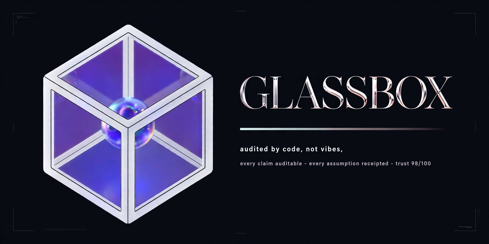

<div align="center">



# GLASSBOX

**AI answers, audited by code — not vibes.**

[](https://modelcontextprotocol.io)
[](https://www.lua.org)
[](https://www.python.org)
[](LICENSE)

</div>

---

## What GLASSBOX does

Glassbox is a **super-thinking + auditing layer for AI coding agents**. When your AI plans something, Glassbox turns its reasoning into a structured artifact — and then questions it.

It forces every plan through a recursive verification loop, scores trust **0–100** with a plain-English verdict, writes the receipts (every assumption, every risk, every step's acceptance check), and renders the whole thing as a neon HTML cockpit — so anyone can see *why* the AI believes its answer.

**No claims without receipts. No plan without a trust score. No reasoning without a verifier signing off.**

<div align="center"></div>

---

## Install — 60 seconds, zero babysitting

**Windows (PowerShell):**

```powershell
git clone https://github.com/DERYK-RYLOY/glassbox.git
cd glassbox
powershell -ExecutionPolicy Bypass -File .\install.ps1
```

**macOS / Linux:**

```bash
git clone https://github.com/DERYK-RYLOY/glassbox.git
cd glassbox
bash ./install.sh
```

The installer: checks Python, installs dependencies, finds/installs Lua, wires Glassbox into OpenCode (or prints the one-line config for your CLI), and verifies itself with `glassbox_status`. If something is missing, it tells you exactly what to do — it never installs anything you didn't consent to.

Manual setup (any CLI that speaks [MCP](https://modelcontextprotocol.io)):

```jsonc
{ "mcp": { "servers": { "glassbox": {
  "type": "local",
  "command": ["python", "<path-to-glassbox>/python/glassbox_server.py"]
} } } }
```

---

## The toolkit

| Icon | Tool | What it does |
|:---:|---|---|
| 🧭 | `glassbox_status` | Health check + which backend is active (Lua / Python fallback) |
| 🗺️ | `glassbox_plan_skeleton` | Turns a goal into a filled-in-by-your-AI structured plan |
| ✅ | `glassbox_validate_plan` | Structural check: dup IDs, dangling deps, missing rationale |
| 🔍 | `glassbox_verify_plan` | Deep audit: dependency cycles, SPOFs, high-risk steps, rollback coverage |
| 📊 | `glassbox_trust_report` | 0–100 trust score with a plain-English verdict (`SOLID` / `WORKABLE` / `FRAGILE` / `DO NOT EXECUTE`) |
| 📋 | `glassbox_render` | Render plans as **ASCII tables** or **Mermaid flowcharts** |
| 🗣️ | `glassbox_explain` | Plain-language walkthrough: what, why, receipts, definition of done |
| 🐝 | `glassbox_swarm` | **Iron Swarm** — recursive 10-agent deep-thinking pipeline (scouts ∥ → analysts ∥ → architect → verifier, looping until PASS) |
| 🪶 | `glassbox_think` | **Tiny Thinker** — a 4.2 MB int8 BERT-Tiny, in-process: relevance gating, dedup, contradiction hints |
| 🎨 | `glassbox_forge` | **The Forge** — combinatorial creativity engine: bisociation, SCAMPER, negation, abstraction ladder. Ranked by the Tiny Thinker |
| 🧠 | `glassbox_deepthink` | The on-demand switch: `think_hard` · `brainstorm` · `todo` |
| 🖼️ | `glassbox_report` | The **GLASSBOX COCKPIT** — one call opens your plan as a neon dashboard in the browser |

**12 tools. One JSON contract. Works everywhere — including CLIs with no MCP at all:**

```bash
# Universal CLI (no MCP, no protocol)
python python/glassbox_cli.py --list
echo '{"title":"ship","goal":"x","steps":[]}' | python python/glassbox_cli.py glassbox_trust_report
```

---

## The 10-second architecture

```
your AI CLI ──MCP──► glassbox_server ──► Iron Swarm v2 (pure Lua, recursive)
                                             3 scouts ∥ ─ Thinker gate ─► 5 analysts ∥
                                             architect ─► verifier (GV|PASS / GV|REVISE ↻)
                                                │
                                    final plan → trust_report(0–100) → receipts
```

* **Agents speak GB1**, a compact tagged dialect — not English prose. ~60–80% less wire chatter.
* **The Tiny Thinker** (4.2 MB, int8 BERT-Tiny) triages signal vs. noise before your model spends tokens on it.
* **The recursive verifier** refuses to ship until the plan survives audit — or reports exactly why it can't.

---

**Every claim auditable · every assumption receipted · trust 98/100.**

MIT licensed. Built with Lua, Python, and stubborn honesty.
